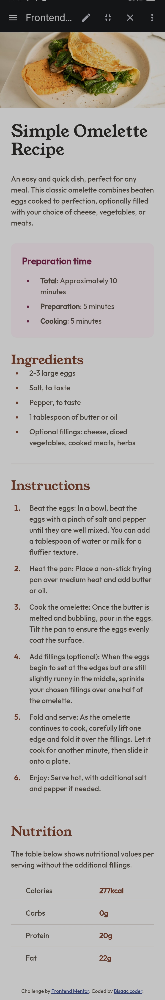

# Frontend Mentor - Recipe page solution

This is a solution to the [Recipe page challenge on Frontend Mentor](https://www.frontendmentor.io/challenges/recipe-page-KiTsR8QQKm). Frontend Mentor challenges help you improve your coding skills by building realistic projects. 

## Table of contents

- [Overview](#overview)
  - [The challenge](#the-challenge)
  - [Screenshot](#screenshot)
  - [Links](#links)
- [My process](#my-process)
  - [Built with](#built-with)
  - [What I learned](#what-i-learned)
  - [Continued development](#continued-development)
  - [Useful resources](#useful-resources)
  - [AI Collaboration](#ai-collaboration)
- [Author](#author)
- [Acknowledgments](#acknowledgments)


## Overview
this is a solution to to the frontend 
mentor coding challenge.

### Screenshot



### Links

- Solution URL: [Bisaac coder](https://github.com/Bisaac-coder/recipe-main-page-)
- Live Site URL: [recipe live site](https://bisaac-coder.github.io/recipe-main-page-/)

## My process
well i struggled for more than
a lot to get the concepts i composed 
the html then followed it with an 
external css styling.

### Built with

- Semantic HTML5 markup
- External CSS
- CSS Grid

### What I learned
well i learnt how to use external 
css styling.

```html
<!DOCTYPE html>
<html lang="en">
<head>
  <meta charset="UTF-8">
  <meta name="viewport" content="width=device-width, initial-scale=1.0"> <!-- displays site properly based on user's device -->

  <link rel="icon" type="image/png" sizes="32x32" href="./favicon-32x32.png">
  <link rel="stylesheet" href="recipe.css">
  <title>Frontend Mentor | Recipe page</title>

  <!-- Feel free to remove these styles or customise in your own stylesheet 👍 -->
  <style>
    .attribution { font-size: 0.6875rem; text-align: center; }
    .attribution a { color: hsl(228, 45%, 44%); }
  </style>
</head>
<body>
  
  <div class="container">
    
    

    <h1 class="head">
        Simple Omelette Recipe
    </h1> 
    
    <div class="firstdiv">
    

    <p class="para">
        An easy and quick dish,
      perfect for any meal. This
      classic omelette combines 
      beaten eggs cooked 
  to perfection, optionally 
      filled with your choice of
      cheese, vegetables, or meats.

    </p>
   </div>
  
      
      <div class="prepdiv">
    <strong class="will">
        Preparation time
    </strong>
    
    <ul class="willi">
        
        <li>
          <span class="jane">Total</span>: Approximately 10 minutes
        </li>
        <li>
          <span class="jane">Preparation</span>: 5 minutes
        </li>
        <li>
          <span class="jane">Cooking</span>: 5 minutes
        </li>
        
    </ul>
  </div>
        
        
    <div class="ingredient">
    <h2 class="headers">
        Ingredients
    </h2>

    
    <ul class="inlist">
        <li>
             2-3 large eggs
        </li>
        
        <li>
            Salt, to taste
        </li>
        
        <li>
            Pepper, to taste
        </li>
        
        <li>
            1 tablespoon of butter or oil
        </li>
        <li>
            Optional fillings: cheese, diced vegetables, cooked meats, herbs

        </li>
    </ul>
     </div>
      
      
    <hr>
     
    <div class="instruction">
    <h2 class="headers ">
        Instructions
    </h2>
  
    <ol class="tucklist">
        <li>
            Beat the eggs: In a bowl, beat the eggs with a pinch of salt and pepper until they are well mixed. 
  You can add a tablespoon of water or milk for a fluffier texture.
        </li>
        <li>
            Heat the pan: Place a non-stick frying pan over medium heat and add butter or oil.
        </li>
        <li>
            Cook the omelette: Once the butter is melted and bubbling, pour in the eggs. Tilt the pan to ensure 
  the eggs evenly coat the surface.
        </li>
        <li>
            Add fillings (optional): When the eggs begin to set at the edges but are still slightly runny in the 
  middle, sprinkle your chosen fillings over one half of the omelette.
        </li>
        <li>
            Fold and serve: As the omelette continues to cook, carefully lift one edge and fold it over the 
  fillings. Let it cook for another minute, then slide it onto a plate.
        </li>
        <li>
            Enjoy: Serve hot, with additional salt and pepper if needed.

        </li>
    </ol>
      </div>
      
  
    <hr>
    
    <div>
    <h2 class="headers">
        Nutrition
    </h2>
  
    <p class="para">
        The table below shows nutritional 
        values per serving without the additional
        fillings.
    </p>
  
    <table>
        <tr>
            <td>
                Calories
            </td>
            <td class="tab">
                277kcal
            </td>
        </tr>
   
        <tr>
            <td>
                Carbs
            </td>
            <td class="tab">
                0g
            </td>
        </tr>
        
        <tr>
            <td>
              Protein
            </td>
            <td class="tab">
              20g  
            </td>
            
        </tr>
        
         <tr>
            <td>
              Fat
            </td>
            <td class="tab">
            22g    
            </td>
        </tr>
    </table>
      
      </div>
    
  
  <footer class="attribution">
    Challenge by <a href="https://www.frontendmentor.io?ref=challenge">Frontend Mentor</a>. 
    Coded by <a href="#">Bisaac-coder</a>.
  </footer>
    
    </div>
    
</body>
</html>
```
```css
@font-face {
  font-family: outfit;
  src: url(./Outfit-Medium.ttf) format("truetype");
}

@font-face {
  font-family: youngserif;
  src: url(./YoungSerif-Regular.ttf) format("truetype");
}

* {
  margin: 0;
  padding: 0;
  box-sizing: border-box;
}

body {
  min-width: 320px;
  font-family: outfit, sans-serif;
  font-size: 16px;
  line-height: 1.5;
  color: hsl(30, 10%, 34%);
  background-color: hsl(0, 0%, 100%);
}

/* ---------- Card ---------- */
.container {
  display: grid;
  gap: 32px;
  max-width: 736px;
  margin: 0 auto;
  padding-bottom: 32px;
  background-color: hsl(0, 0%, 100%);
}

/* On mobile the image goes edge to edge, the rest is padded */
.container > *:not(.image) {
  margin-inline: 24px;
}

.image {
  display: block;
  width: 100%;
  height: auto;
}

/* ---------- Text ---------- */
.head {
  font-family: youngserif, serif;
  font-weight: 400;
  font-size: 2.25rem;
  line-height: 1.1;
  color: hsl(24, 5%, 18%);
}

.headers {
  font-family: youngserif, serif;
  font-weight: 400;
  font-size: 1.75rem;
  line-height: 1.2;
  color: hsl(14, 45%, 36%);
}

.firstdiv,
.para {
  line-height: 1.5;
}

/* ---------- Preparation time box ---------- */
.prepdiv {
  background-color: hsl(330, 100%, 98%);
  border-radius: 12px;
  padding: 24px;
}

.will {
  display: block;
  margin-bottom: 16px;
  font-size: 1.25rem;
  font-weight: 600;
  color: hsl(332, 51%, 32%);
}

.willi {
  padding-left: 24px;
}

.willi li {
  padding-left: 16px;
}

.willi li::marker {
  color: hsl(332, 51%, 32%);
}

.willi li + li {
  margin-top: 8px;
}

.jane {
  font-weight: 600;
}

/* ---------- Ingredients and instructions ---------- */
.in {
  margin-bottom: 20px;
}

.inlist,
.tucklist {
  padding-left: 24px;
}

.inlist li,
.tucklist li {
  padding-left: 16px;
}

.inlist li + li,
.tucklist li + li {
  margin-top: 8px;
}

.inlist li::marker,
.tucklist li::marker {
  color: hsl(14, 45%, 36%);
  font-weight: 600;
}

.instruction .headers {
  margin-bottom: 20px;
}

.tucklist li + li {
  margin-top: 12px;
}

/* ---------- Divider ---------- */
hr {
  border: none;
  border-top: 1px solid hsl(30, 18%, 87%);
}

/* ---------- Nutrition table ---------- */
.container > div:has(table) .headers {
  margin-bottom: 20px;
}

.container > div:has(table) .para {
  margin-bottom: 20px;
}

table {
  width: 100%;
  border-collapse: collapse;
}

td {
  padding: 12px 0 12px 32px;
  border-bottom: 1px solid hsl(30, 18%, 87%);
}

tr:last-child td {
  border-bottom: none;
}

.tab {
  font-weight: 700;
  color: hsl(14, 45%, 36%);
}

/* ---------- Footer ---------- */
.attribution {
  margin-top: 8px;
}

/* ---------- Desktop ---------- */
@media (min-width: 768px) {
  body {
    padding: 120px 24px;
    background-color: hsl(30, 54%, 90%);
  }

  .container {
    padding: 40px;
    border-radius: 24px;
    gap: 40px;
  }

  .container > *:not(.image) {
    margin-inline: 0;
  }

  .image {
    border-radius: 12px;
  }

  .head {
    font-size: 2.5rem;
  }
}

```


### Continued development
i want to continue to develop my skill in
external css .

### Useful resources

- [Claude] - This helped me for both css and html . I really liked this pattern and will use it going forward.


### AI Collaboration


- What tools did you use (e.g., ChatGPT, Claude, GitHub Copilot)?
Claude
- How did you use them (e.g., debugging, generating boilerplate, brainstorming solutions)?
debugging and brainstorming
- What worked well?
claude helped me

 What didn't?
nothing


## Author


- Frontend Mentor - [@Bisaac-coder](https://www.frontendmentor.io/profile/Bisaac-coder)
- Twitter - [@isaackbags](https://www.twitter.com/isaackbags)


## Acknowledgments

special thanks to kenedy bok 
future full stack.
